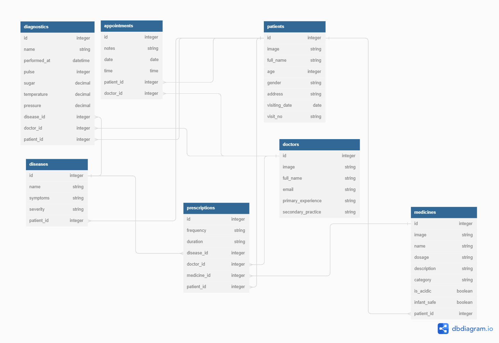
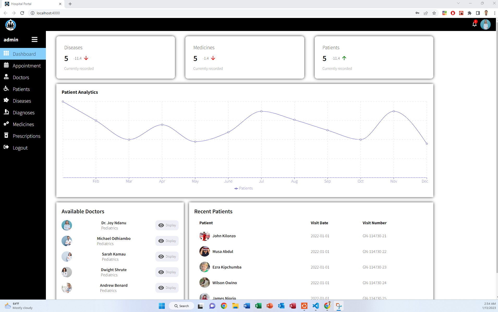
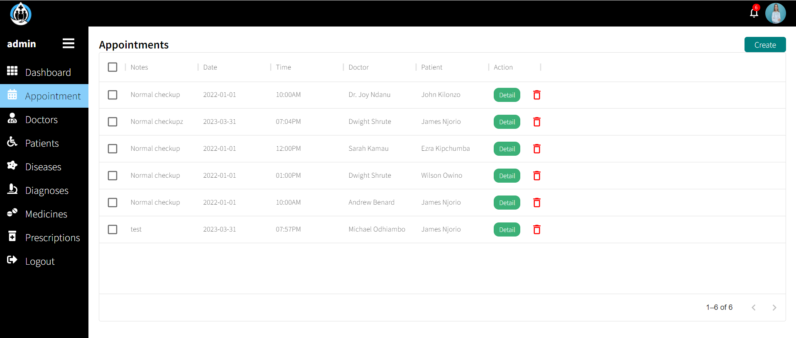
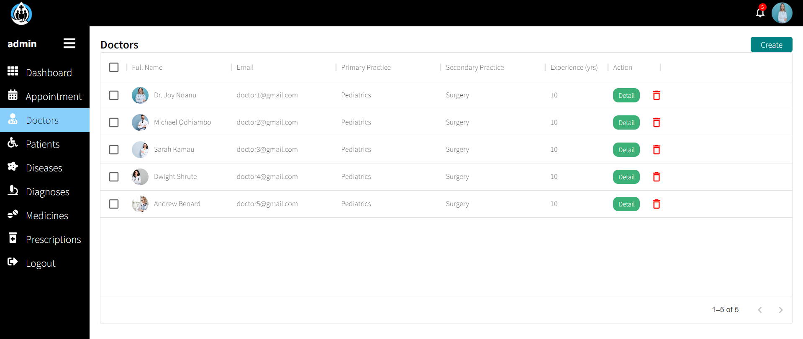
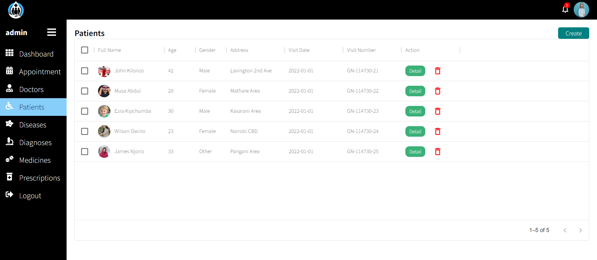
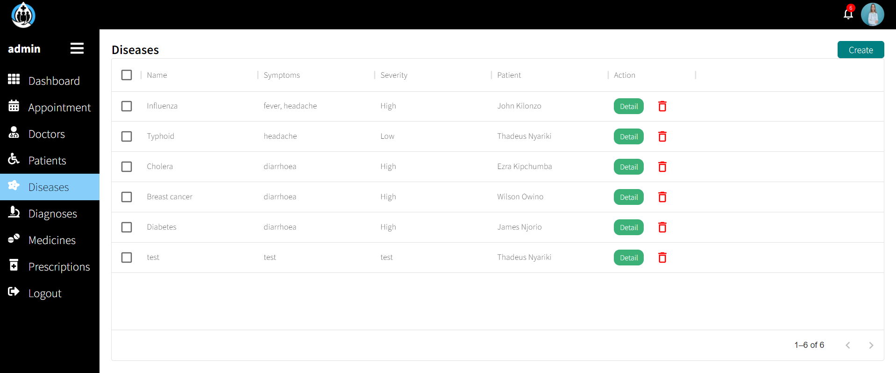
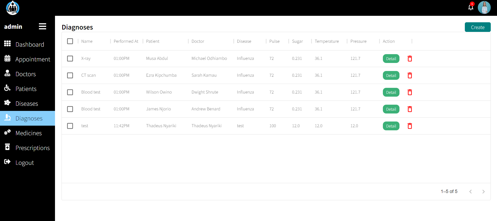
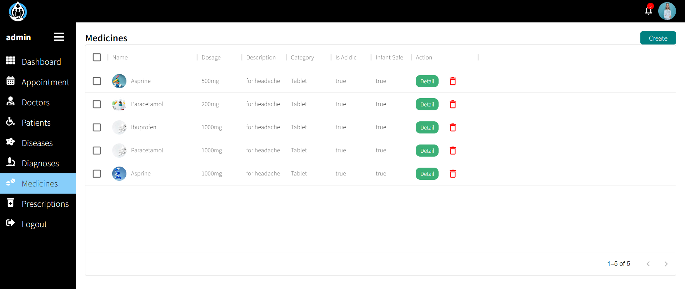
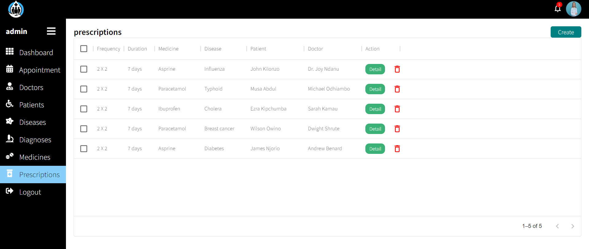
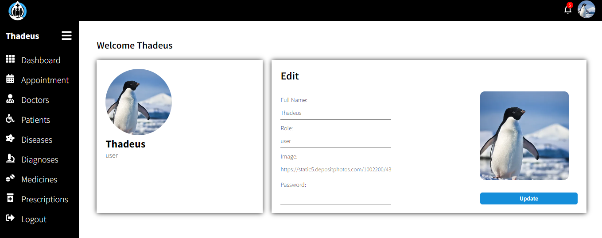

# HOSPITAL MANAGEMENT SYSTEM
- Is a Full-stack application. i.e React - Frontend & Rails Backend.
## Problem Statement
- Hospitals are full of recorded data; Handling this amount of data in terms of storage and retrieval on a daily basis is a major challenge.
## Solution
- Developing a web application that enables medical staff and professionals to conveniently store and retrieve records on a regular basis.
## Backend(ERD)

## Minimum Viable Product
1. Record doctors and their appointments.
2. record patients, their diagnosis and prescriptions
3. Record medicines, their categories and descriptions.
4. Record various diseases and symptoms.
## Technologies
* **Ruby On Rails** - For setting up the application backend.
* **Postgres** - For setting up database.
* **React** - For building user interfaces.
* **CSS** - For styling the application.
* **Render** - For deploying the application.
## User Experience
### Dashboard

### Doctor Appointments

### Doctors

### Patients

### Diseases

### Diagnostics

### Medicines

### Prescriptions

### User account

## How to Run App
1. Comment out first validations for patient and user at their respective models
2. Open terminal and run ``bundle install`` to install the necessary gems
3. Run ``rails db:create``
3. Run ``rails db:migrate db:seed``
4. Run ``rails s`` to start rails server (backend).
5. Open a different terminal and run ``npm install --prefix client`` to install the required dependencies
6. Run ``npm start --prefix client`` to start react frontend.
7. Sign up and login to enjoy the App.

## Deploying to Render

This repository includes a Render Blueprint in [`render.yaml`](./render.yaml). It deploys the React client and Rails API together in one Docker web service and provisions a PostgreSQL database. Keeping them on one origin lets the existing session-based login work without cross-origin configuration.

1. Push the repository to GitHub and create a Blueprint in the [Render Dashboard](https://dashboard.render.com/blueprints), selecting this repository.
2. Apply the Blueprint. Render builds the production stage in `Dockerfile`, runs database migrations on startup, and checks the `/up` health endpoint.
3. Open the deployed service URL, sign up, and log in.

The Blueprint uses Render's free plans for evaluation. Free PostgreSQL databases are temporary and can expire; change the database and web service plans before relying on this deployment. Do not use the free setup for real patient information. The demo seed data also creates a known `admin` / `root` account, so do not run `rails db:seed` on a public deployment.
